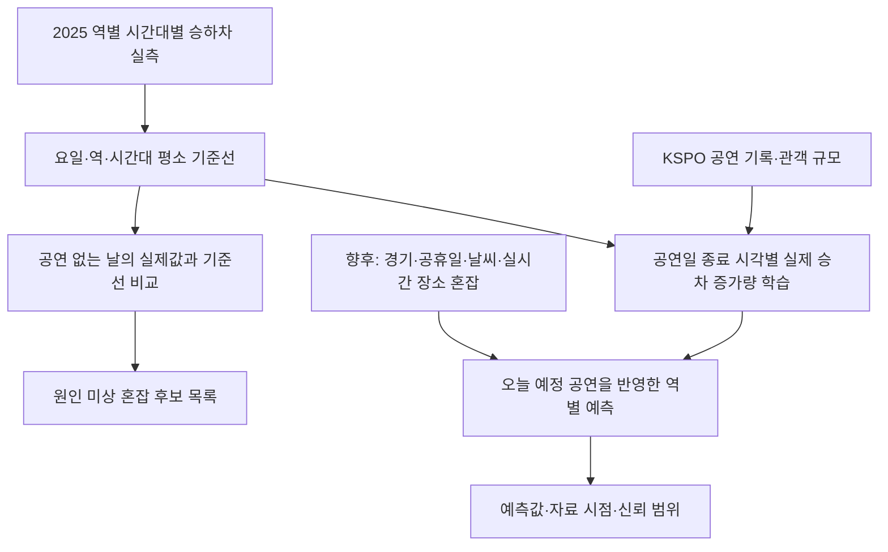

# 행사일 중심 혼잡 예측 설계

## 목표

2025년 역별·시간대별 승차 실측을 정답 자료로 삼아, 오늘 예정된 공연의 종료 시각과 규모가 역별 귀가 승차에 미치는 영향을 추정한다. 공연이 없는 날은 평소 기준선을 만드는 데 쓰고, 기준선보다 크게 붐빈 날은 별도의 '원인 미상 혼잡 후보'로 기록한다.

공연이 없는 날의 돌발 원인을 모르면 미래 날짜에 그 혼잡이 발생한다고 예측할 수 없다. 따라서 후보 날짜를 실제 원인을 확인하기 전까지 공연·축구·집회 등으로 이름 붙이지 않는다. 향후 경기·휴일·날씨·실시간 현장 관측 자료를 연결하면 그 원인을 설명 변수로 추가한다.

## 흐름

## 지금 구현하는 범위

- 기존 모델의 공연일 효과 학습을 유지한다. 실측 승차에서 평소 기준선을 뺀 값을 관객 규모와 비교한다.
- KSPO가 기록을 제공한 날짜 중 감지된 공연이 없는 날짜에서 기준선 대비 1.5배 이상인 역·시각을 후보로 뽑는다.
- 후보 탐지는 날짜를 기준선 표본에서 제외하는 방식으로 계산한다.
- 후보는 학습 정답이나 알려진 행사로 취급하지 않는다. 기존 요일별 중앙값은 이상치에 비교적 강하므로 그대로 사용한다.

## 실시간 정보의 역할

현재 공개 자료에서 확인한 실시간 정보는 서울 주요 장소의 인구 혼잡 지표와 대중교통 승하차 누계, 역별 열차 도착·위치다. 역별 열차 승객 혼잡도를 실시간으로 직접 제공하는 공개 API는 확인하지 못했다. 장소 인구 혼잡도는 역 승차량과 측정 대상이 다르므로 모델 정답으로 대체하지 않고, 제공 범위·장소가 맞으면 현장 참고 신호로 별도 사용한다.
